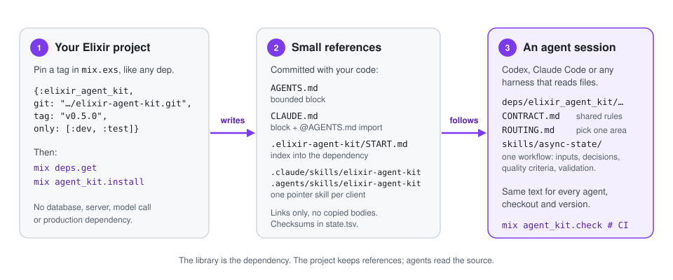

# Elixir Agent Kit

[](https://github.com/sallaumen/elixir-agent-kit/actions/workflows/ci.yml)
[](https://github.com/sallaumen/elixir-agent-kit/releases)
[](mix.exs)
[](LICENSE)

**Shared coding practices for AI agents, versioned with your Elixir project.**

Pin the kit like any Mix dependency. Every agent that touches the project, whether
Codex, Claude Code or your own harness, reads the same 36 reviewed workflows from
`deps/`: what to inspect, which decisions matter, what "done" looks like and how
to prove it. No copied skill library to drift, no service, no model calls, nothing
shipped to production.

<p align="center">
  
</p>

## Why a dependency

- **One source, many agents, many projects.** A workflow improves once, in
  `priv/library/`, ships as a tag, and each application adopts it in a normal
  dependency PR. Two agents on the same checkout read identical text.
- **Workflows that say what to do, not how to feel.** Each `SKILL.md` names the
  inputs to inspect, the decision points, quality criteria, the evidence that
  validates the result and the pitfalls. See
  [`async-state`](priv/library/skills/async-state/SKILL.md) for the shape.
- **Honest by design.** The installer writes references and checksums, never a
  copy of a workflow. `mix agent_kit.check` runs offline in CI and fails on drift
  or when a library file the links point at is missing.
  Nothing here claims that a model followed the text; that is checked in a fresh
  session, as [compatibility](docs/compatibility.md) describes.

## Quick start

Requires Elixir 1.15+, a compatible Erlang/OTP and Git. Releases are public Git
tags, **not Hex**; no token is needed.

**1. Add the dependency** to `deps/0` in `mix.exs`:

```elixir
{:elixir_agent_kit,
 git: "https://github.com/sallaumen/elixir-agent-kit.git",
 tag: "v0.6.0",
 only: [:dev, :test],
 runtime: false}
```

**2. Choose the agents and workflows** in `project/0`:

```elixir
elixir_agent_kit: [agents: [:codex, :claude, :generic], skills: :all]
```

**3. Install** from the Mix project root (check your own aliases first; the kit
runs no application, database or `mix setup`):

```sh
mix deps.get
mix agent_kit.install
mix agent_kit.check
```

You will see the paths the installer wrote and the next step:

```text
Changed 7 paths:
  .agents/skills/elixir-agent-kit/SKILL.md
  .claude/skills/elixir-agent-kit/SKILL.md
  .elixir-agent-kit/START.md
  .elixir-agent-kit/plans/.gitignore
  .elixir-agent-kit/state.tsv
  AGENTS.md
  CLAUDE.md

Next: run mix agent_kit.check, commit these paths, then ask a fresh agent
session to follow .elixir-agent-kit/START.md and name the workflow it selects.
```

Commit `mix.exs`, `mix.lock` and those paths. Do not commit `deps/`. Add
`mix agent_kit.check` to the gate that runs after `mix deps.get`. Prefer
`mix agent_kit.install --dry-run` when you want to see the plan first, and the
[AI installation prompt](docs/INSTALL_WITH_AI.md) when an agent does the setup.

## What an agent does with it

> "After reconnecting, a late message marks the previous task as done and hides
> the progress of the current one."

The session loads `AGENTS.md` or `CLAUDE.md` and follows the block to
`.elixir-agent-kit/START.md`, or finds the generated `elixir-agent-kit` skill in
its own skill directory. Either one asks for five steps before any source file
is opened:

1. It names the task's primary risk in one line, from the request alone: here,
   process state. It also names the size: here, medium.
2. It picks one workflow from the tables in `START.md`, the narrowest that fits:
   [`async-state`](priv/library/skills/async-state/SKILL.md). Only when two
   neighbors fit does it open the [routing guide](priv/library/ROUTING.md) to
   separate them; a bounded, fully specified edit picks NONE.
3. It reads that workflow's `SKILL.md` from the dependency together with the
   [shared contract](priv/library/CONTRACT.md), copying neither into the project.
   The workflow tells it what to inspect (event and job lifecycle, stable IDs,
   reconnect behavior), what to decide (one durable state owner; idempotency per
   effect), what quality looks like (the UI reconciles after reload from persisted
   identifiers; retries never advance state falsely) and what evidence to show
   (duplicate, delayed and out-of-order delivery exercised on the real flow).
4. It states the workflow ID, or NONE, and the size in its reply with the reason
   in one line,
   opens the workflow's `Start at` input before anything else and produces the
   artifact the workflow's first step asks for; then it investigates the way the
   workflow says and reports with the [handoff template](priv/library/HANDOFF.md):
   outcome, workflow and version used, checks actually run, limits.
5. When the task is large (it crosses contexts, touches stored data and code
   together, needs more than one delivery or will not fit one session), it writes
   a plan from the [task-plan template](priv/library/templates/task-plan.md) in
   `.elixir-agent-kit/plans/` before the first edit and rereads it after a
   compaction. It asks for approval of the plan only when it widens the requested
   scope, changes persisted data or a public contract, or has an irreversible step;
   authority rules, the mode and the workflow's own stop conditions still apply.

The routing cases in [`evals/`](evals/README.md) hold 62 requests like that one,
with the expected workflow and the signals of a good or bad answer. They stay out
of the installed payload so an agent never sees the answer key.

## The catalog at a glance

Pick the area, then the narrowest trigger. Every entry links to the full workflow;
the [catalog](priv/library/CATALOG.md) lists the trigger sentences. Operational
domains are product patterns; a project without them can leave those IDs out of
its `skills:` selection.

| Frontend and user experience | Backend and data | Code structure and quality | Operational domains | Delivery and build |
|---|---|---|---|---|
| [ui-identity](priv/library/skills/ui-identity/SKILL.md) | [data-contracts](priv/library/skills/data-contracts/SKILL.md) | [architecture-review](priv/library/skills/architecture-review/SKILL.md) | [ai-orchestration](priv/library/skills/ai-orchestration/SKILL.md) | [delivery-coordination](priv/library/skills/delivery-coordination/SKILL.md) |
| [layout-density](priv/library/skills/layout-density/SKILL.md) | [migration-compatibility](priv/library/skills/migration-compatibility/SKILL.md) | [abstraction-layers](priv/library/skills/abstraction-layers/SKILL.md) | [notifications](priv/library/skills/notifications/SKILL.md) | [pipeline-design](priv/library/skills/pipeline-design/SKILL.md) |
| [navigation-ux](priv/library/skills/navigation-ux/SKILL.md) | [security-boundaries](priv/library/skills/security-boundaries/SKILL.md) | [module-design](priv/library/skills/module-design/SKILL.md) | [operational-alerts](priv/library/skills/operational-alerts/SKILL.md) | [build-dependencies](priv/library/skills/build-dependencies/SKILL.md) |
| [responsive-layout](priv/library/skills/responsive-layout/SKILL.md) | [provider-calls](priv/library/skills/provider-calls/SKILL.md) | [code-consolidation](priv/library/skills/code-consolidation/SKILL.md) | [integration-setup](priv/library/skills/integration-setup/SKILL.md) | [delivery-validation](priv/library/skills/delivery-validation/SKILL.md) |
| [direct-interactions](priv/library/skills/direct-interactions/SKILL.md) | [data-pipelines](priv/library/skills/data-pipelines/SKILL.md) | [test-strategy](priv/library/skills/test-strategy/SKILL.md) | [metrics-costs](priv/library/skills/metrics-costs/SKILL.md) |  |
| [accessibility](priv/library/skills/accessibility/SKILL.md) |  | [code-review](priv/library/skills/code-review/SKILL.md) | [simulation-isolation](priv/library/skills/simulation-isolation/SKILL.md) |  |
| [design-system](priv/library/skills/design-system/SKILL.md) |  | [debugging](priv/library/skills/debugging/SKILL.md) | [commercial-eligibility](priv/library/skills/commercial-eligibility/SKILL.md) |  |
| [motion-design](priv/library/skills/motion-design/SKILL.md) |  | [performance](priv/library/skills/performance/SKILL.md) | [revision-lineage](priv/library/skills/revision-lineage/SKILL.md) |  |
|  |  | [async-state](priv/library/skills/async-state/SKILL.md) |  |  |
|  |  | [process-lifecycle](priv/library/skills/process-lifecycle/SKILL.md) |  |  |
|  |  | [house-patterns](priv/library/skills/house-patterns/SKILL.md) |  |  |

Three of them keep a different default mode: `code-review` reviews without
editing, `delivery-validation` analyzes without repairing, `delivery-coordination`
coordinates. The user's explicit scope always wins over a default. The
[Elixir context](priv/library/ELIXIR.md) indexes one short reference per subject
(code shape, pipelines, dependency architecture, OTP, Phoenix and LiveView, Ecto,
Oban, ExUnit, HTTP clients, security, telemetry, builds, library authoring, the
agent's working loop) and the recommended libraries; an agent reads only the ones
the project's `mix.lock` and task call for.

## What lands in your project

| Path | Purpose |
|---|---|
| `.elixir-agent-kit/START.md` | Five steps that end in a named workflow choice and a task size, then the enabled catalog linking into the dependency. |
| `.elixir-agent-kit/state.tsv` | Version, selection and SHA-256 of every file and block the installer owns. |
| `.elixir-agent-kit/plans/.gitignore` | Keeps the plans folder out of Git without touching your `.gitignore`; large tasks write their plans next to it, and uninstall keeps those plans, no longer ignored. The folder is not versioned, so a plan does not follow the task into another worktree. |
| `AGENTS.md` | A bounded block for Codex and generic harnesses (`:codex`, `:generic`). |
| `CLAUDE.md` | A bounded block for Claude Code (`:claude`). When `AGENTS.md` is managed or already exists, the block imports it with `@AGENTS.md`, because Claude Code stops reading `AGENTS.md` once a `CLAUDE.md` applies. |
| `.claude/skills/elixir-agent-kit/SKILL.md` | One generated skill for Claude Code's native discovery: a description, the catalog filtered by your selection and links into the dependency. |
| `.agents/skills/elixir-agent-kit/SKILL.md` | The same generated skill for Codex. |

Text outside the managed blocks is yours and survives every sync. No workflow
body is ever copied; the library stays in `deps/elixir_agent_kit/priv/library/`.
A pre-existing skill named `elixir-agent-kit` blocks installation until renamed.
Custom dependency paths are resolved by Mix; an external local path dependency
produces absolute links and needs a resync after moving. In an umbrella, run the
tasks from the umbrella root: from an application directory the shared `deps/`
lies outside the project root, so the links come out absolute. `mix agent_kit.check`
compares every owned path with what the loaded package would generate and also
verifies that the library files the links point at exist.

## Commands

| Command | Effect |
|---|---|
| `mix agent_kit.list` | Prints workflow IDs, modes and triggers grouped by area. |
| `mix agent_kit.install` | Creates or synchronizes references after a conflict preflight; an alias of `sync`. |
| `mix agent_kit.sync` | The same reconciliation: regenerates owned files and blocks, removes unmodified legacy generated files, refuses locally modified managed content. |
| `mix agent_kit.check` | Offline, read-only comparison against the loaded package and configuration, plus a check that every library file the links point at exists; fails on drift. |
| `mix agent_kit.outdated` | Queries public stable Git tags and reports loaded versus latest; `--check` fails when a newer tag exists. |
| `mix agent_kit.uninstall` | Removes owned, unmodified references and state; prunes only directories it emptied. |

`install`, `sync` and `check` accept `--agents codex,claude,generic` and
`--skills ID,ID` for one run; `install`, `sync` and `uninstall` accept `--dry-run`.
When `project/0` declares `:elixir_agent_kit`, that entry is the source of truth
and a key you remove falls back to its default; without the entry, the selection
recorded in `.elixir-agent-kit/state.tsv` is kept. Narrow discovery with
`skills: ["debugging", "code-review"]`; selection shapes the index and the pointer
skills, it is not an access boundary. A project with a `CLAUDE.md` and no `:claude`
selection gets a note, because Claude Code would not see the kit. No task starts
your application or calls a model.

## Upgrades and one shared source

1. Read the [changelog](CHANGELOG.md); `mix agent_kit.outdated` tells you whether a newer tag exists.
2. Change the tag in `mix.exs` and run `mix deps.update elixir_agent_kit`.
3. Run `mix agent_kit.sync --dry-run`, inspect, then `mix agent_kit.sync`.
4. Run `mix agent_kit.check` and your project gates; commit the diff.

Reusable lessons go upstream through the [evolution policy](priv/library/EVOLUTION.md)
and the [proposal template](priv/library/templates/practice-proposal.md); product
rules stay in the application. A 0.1 installation migrates the same way: sync
removes its recorded copies and `eak-*` wrappers and keeps everything it does not
own. Edited managed content, unknown collisions, malformed markers and symlinked
outputs block every write before it starts; there is no force switch.

## Guarantees and limits

- Zero third-party Elixir dependencies in your project, no telemetry, no global
  client configuration, no credentials.
- `check` is offline and verifies this installation, not freshness; `outdated` is
  an explicit network query, never a background updater.
- A fresh checkout needs `mix deps.get` before any agent can read a workflow, and
  the client must be able to read ignored `deps/` files. A DeepSeek-backed or
  custom harness must load `AGENTS.md` or the index in its actual worktree.
- Structural tests and consumer smoke tests prove links, preservation and
  migration. They do not prove that a live client discovered or followed a
  practice. Use the fresh-session procedure in [compatibility](docs/compatibility.md).

## Documentation

[Documentation map](docs/README.md) ·
[Install with an AI agent](docs/INSTALL_WITH_AI.md) ·
[Português](docs/README.pt-BR.md) ·
[Architecture](docs/architecture.md) ·
[Compatibility and live evaluation](docs/compatibility.md) ·
[Provenance](docs/provenance.md) ·
[Contributing](CONTRIBUTING.md) ·
[Security](SECURITY.md) ·
[MIT license](LICENSE)
