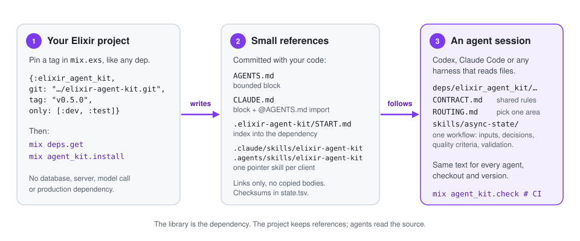

# Elixir Agent Kit

**Práticas de código compartilhadas para agentes de IA, versionadas junto com o seu projeto Elixir.**

Fixe o kit como qualquer dependência Mix. Todo agente que trabalhar no projeto, seja
Codex, Claude Code ou o seu próprio harness, lê os mesmos 35 workflows revisados
direto de `deps/`: o que inspecionar, quais decisões importam, o que é "pronto" e
como provar. Sem biblioteca copiada que envelhece, sem serviço, sem chamada a
modelo, nada vai para produção.

<p align="center">
  
</p>

## Começo rápido

Requer Elixir 1.15+, Erlang/OTP compatível e Git. As releases são tags públicas do
GitHub, **não Hex**; não há token.

**1. Adicione a dependência** em `deps/0` no `mix.exs`:

```elixir
{:elixir_agent_kit,
 git: "https://github.com/sallaumen/elixir-agent-kit.git",
 tag: "v0.4.0",
 only: [:dev, :test],
 runtime: false}
```

**2. Escolha agentes e workflows** em `project/0`:

```elixir
elixir_agent_kit: [agents: [:codex, :claude, :generic], skills: :all]
```

**3. Instale** a partir da raiz do projeto Mix (confira os aliases locais antes; o
kit não inicia aplicação, banco nem `mix setup`):

```sh
mix deps.get
mix agent_kit.install
mix agent_kit.check
```

O instalador lista os caminhos escritos e o próximo passo. Versione `mix.exs`,
`mix.lock` e esses caminhos; não versione `deps/`. Coloque `mix agent_kit.check`
no gate que roda depois de `mix deps.get`. Para ver o plano antes, use
`mix agent_kit.install --dry-run`; para um agente fazer a instalação, use o
[prompt de instalação](INSTALL_WITH_AI.md).

## O que fica no projeto

| Caminho | Para quê |
|---|---|
| `.elixir-agent-kit/START.md` | Índice pequeno apontando para contrato, guia de seleção e catálogo na dependência. |
| `.elixir-agent-kit/state.tsv` | Versão, seleção e SHA-256 de cada arquivo e bloco que o instalador possui. |
| `AGENTS.md` | Bloco delimitado para Codex e harnesses genéricos. |
| `CLAUDE.md` | Bloco delimitado para Claude Code. Quando `AGENTS.md` é gerenciado ou já existe, o bloco o importa com `@AGENTS.md`, porque o Claude Code deixa de ler `AGENTS.md` assim que um `CLAUDE.md` se aplica. |
| `.claude/skills/elixir-agent-kit/SKILL.md` | Uma skill gerada para a descoberta nativa do Claude Code: descrição, catálogo filtrado pela sua seleção e links para a dependência. |
| `.agents/skills/elixir-agent-kit/SKILL.md` | A mesma skill gerada, para o Codex. |

Texto fora dos blocos gerenciados é seu e sobrevive a todo `sync`. Nenhum corpo de
workflow é copiado. Uma skill pré-existente chamada `elixir-agent-kit` bloqueia a
instalação até ser renomeada.

## Como um agente usa

1. A sessão carrega `AGENTS.md` ou `CLAUDE.md` e segue o bloco até `START.md`, ou
   encontra a skill `elixir-agent-kit` no seu diretório nativo de skills.
2. Lê o [contrato compartilhado](../priv/library/CONTRACT.md) e o
   [guia de seleção](../priv/library/ROUTING.md); escolhe o workflow mais estreito
   no [catálogo](../priv/library/CATALOG.md), agrupado em frontend, backend,
   engenharia transversal e entrega.
3. Aplica os critérios de qualidade e validação daquele `SKILL.md` e entrega com o
   [template de handoff](../priv/library/HANDOFF.md): resultado, workflow e versão
   usados, checks executados, limites.

## Atualizar e manter uma fonte só

Leia o [changelog](../CHANGELOG.md), troque a tag no `mix.exs`, rode
`mix deps.update elixir_agent_kit`, `mix agent_kit.sync --dry-run`,
`mix agent_kit.sync` e `mix agent_kit.check`. `mix agent_kit.outdated` consulta as
tags públicas sem alterar nada; com `--check`, falha quando há versão mais nova.
Não há atualização automática.

Melhorias reutilizáveis sobem para o kit pela
[política de evolução](../priv/library/EVOLUTION.md); regras de domínio ficam no
projeto. Edições em conteúdo gerenciado, colisões e marcadores malformados bloqueiam
qualquer escrita antes de começar; não existe `--force`.

## Garantias e limites

- Zero dependências Elixir de terceiros, sem telemetria, sem configuração global de
  cliente, sem credenciais.
- Um checkout novo precisa de `mix deps.get` antes de qualquer agente ler um
  workflow, e o cliente precisa conseguir ler arquivos ignorados em `deps/`.
- Testes estruturais e smoke provam links, preservação e migração. Não provam que
  um cliente vivo descobriu ou seguiu uma prática; para isso existe o procedimento
  de sessão nova em [compatibilidade](compatibility.md).

Veja também o [guia principal em inglês](../README.md) e o
[mapa da documentação](README.md).
